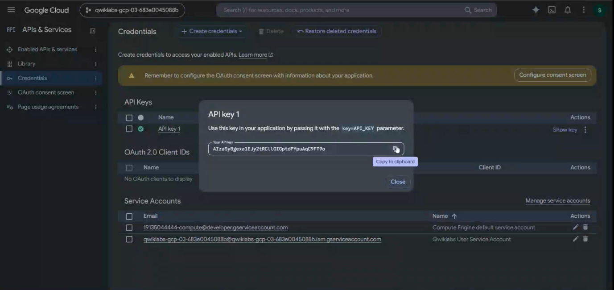
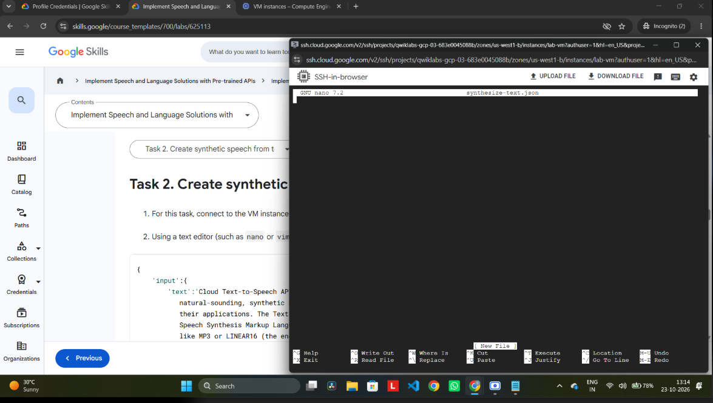
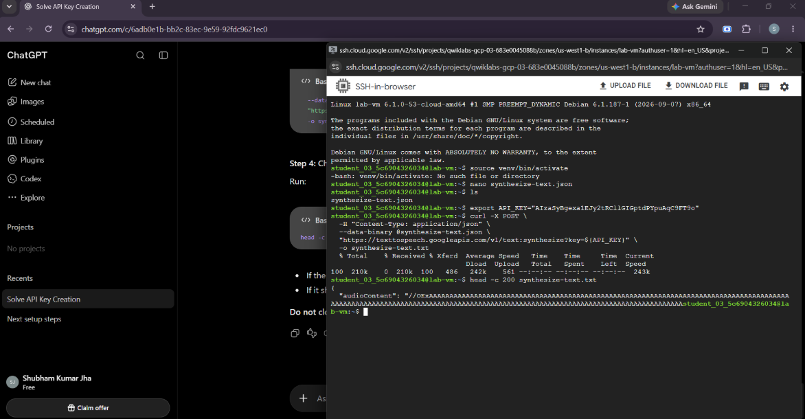
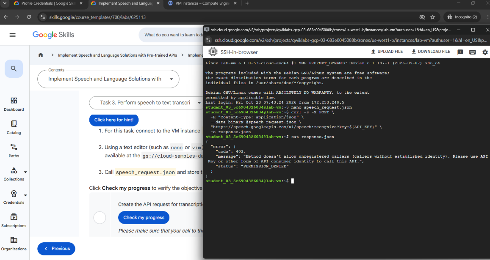
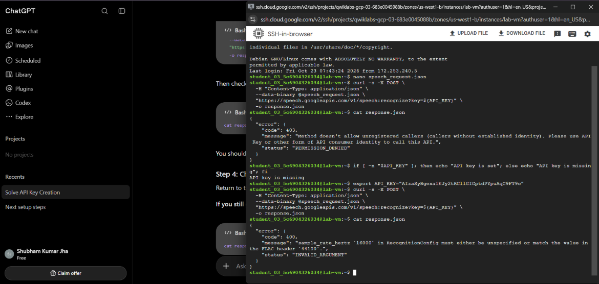

# ARC 132 Lab Guide

> Converted from the provided Word document. Embedded images are stored in the `images/` folder.

## TASK1

#### Step 1: Open Google Cloud Console

1. Click Open Google Cloud console in the right-side panel.

2. Sign in using the lab-provided username and password shown in that panel.

3. Make sure you are using the correct lab project, not your personal Google Cloud project.

#### Step 2: Create the API key

1. Open APIs & Services → Credentials

In the Google Cloud Console, use the navigation menu or search bar to find Credentials.

2. Create the key

Click + Create credentials → API key. Wait for the key to be generated.

3. Save the API key

Copy the key and save it somewhere temporary for the next tasks. Do not share it publicly.

#### Step 3: Verify your lab progress

## TASK2

#### Step 1: Open Google Cloud Console

1. Click the Lab setup button near the top-right if you need to find your VM credentials.

2. Open the Google Cloud Console in your lab account.

3. Navigate to Compute Engine → VM instances.

4. Find the VM named lab-vm and click SSH beside it.

#### Step 2: Activate the Python environment

In the SSH terminal, run:

source venv/bin/activate

#### Step 3: Create synthesize-text.json

Run:

nano synthesize-text.json

Paste this JSON into the editor:

{

"input": {

"text": "Cloud Text-to-Speech API allows developers to include natural-sounding, synthetic human speech as playable audio in their applications. The Text-to-Speech API converts text or Speech Synthesis Markup Language (SSML) input into audio data like MP3 or LINEAR16 (the encoding used in WAV files)."

},

"voice": {

"languageCode": "en-gb",

"name": "en-GB-Standard-A",

"ssmlGender": "FEMALE"

},

"audioConfig": {

"audioEncoding": "MP3"

}

}

Save the file in nano:

- Press Ctrl + O, then Enter.

- Press Ctrl + X.

#### Step 4: Call the Text-to-Speech API

First, set your API key in the terminal. Replace the placeholder with the key you created in Task 1:

export API_KEY="YOUR_API_KEY_HERE"

{Find Your API KEY AND PASTE IT INTO THE  CODE ABOVE }

Then run:

curl -X POST \

-H "Content-Type: application/json" \

--data-binary @synthesize-text.json \

"https://texttospeech.googleapis.com/v1/text:synthesize?key=${API_KEY}" \

-o synthesize-text.txt

Check whether the response contains audioContent:

head -c 200 synthesize-text.txt

#### Step 5: Create the audio decoder

Run:

nano tts_decode.py

Paste this code:

import argparse

from base64 import decodebytes

import json

def decode_tts_output(input_file, output_file):

with open(input_file) as input_file_handle:

response = json.load(input_file_handle)

audio_data = response['audioContent']

with open(output_file, "wb") as new_file:

new_file.write(decodebytes(audio_data.encode('utf-8')))

if __name__ == '__main__':

parser = argparse.ArgumentParser()

parser.add_argument('--input', required=True)

parser.add_argument('--output', required=True)

args = parser.parse_args()

decode_tts_output(args.input, args.output)

Save using Ctrl + O, Enter, then Ctrl + X.

Now generate the MP3:

python3 tts_decode.py --input "synthesize-text.txt" --output "synthesize-text-audio.mp3"

(IF NOT COMPLTED HERE RUN THE BELOW CODES AGAIN)

You are in the correct place! The nano synthesize-text.json editor is open, and the file is currently empty.

#### Step 1: Paste the JSON

{

"input": {

"text": "Cloud Text-to-Speech API allows developers to include natural-sounding, synthetic human speech as playable audio in their applications. The Text-to-Speech API converts text or Speech Synthesis Markup Language (SSML) input into audio data like MP3 or LINEAR16 (the encoding used in WAV files)."

},

"voice": {

"languageCode": "en-GB",

"name": "en-GB-Standard-A",

"ssmlGender": "FEMALE"

},

"audioConfig": {

"audioEncoding": "MP3"

}

}

#### Step 2: Save the file

Press Ctrl + O.

Press Enter to confirm the filename.

Press Ctrl + X to exit.

#### Step 3: Run the API request

After you return to the terminal prompt, run:

Is

Then run the following command, replacing YOUR_API_KEY_HERE with your actual API key from Task 1:

export API_KEY="YOUR_API_KEY_HERE"

Next, execute:

curl -X POST \

-H "Content-Type: application/json" \

--data-binary @synthesize-text.json \

"https://texttospeech.googleapis.com/v1/text:synthesize?key=${API_KEY}" \

-o synthesize-text.txt

#### Step 4: Check the result

Run:

head -c 200 synthesize-text.txt

(Do not close the SSH window yet. We still need to create the audio file and verify Task 2 in your lab.)

AFTER THAT

#### Step 1: Create the MP3 audio file

In the SSH terminal, copy and run this command:

nano tts_decode.py

Paste this code:

import json

import base64

with open("synthesize-text.txt", "r") as f:

response = json.load(f)

with open("synthesize-text-audio.mp3", "wb") as f:

f.write(base64.b64decode(response["audioContent"]))

Save and exit:

Press Ctrl + O, then Enter.

Press Ctrl + X.

#### Step 2: Run the Python script

Run:

python3 tts_decode.py

Then verify that the MP3 file exists:

ls -lh synthesize-text-audio.mp3

#### Step 3: Check Task 2 progress

## TASK3

#### Step 1: Create speech_request.json

In your SSH terminal, run:

nano speech_request.json

Paste this JSON exactly:

{

"config": {

"encoding": "FLAC",

"sampleRateHertz": 16000,

"languageCode": "fr-FR"

},

"audio": {

"uri": "gs://cloud-samples-data/speech/corbeau_renard.flac"

}

}

Save the file:

Press Ctrl + O.

Press Enter.

Press Ctrl + X.

#### Step 2: Call the Speech-to-Text API

Run this command in the SSH terminal:

curl -s -X POST \

-H "Content-Type: application/json" \

--data-binary @speech_request.json \

"https://speech.googleapis.com/v1/speech:recognize?key=${API_KEY}" \

-o response.json

Run:

cat response.json

#### Step 4: Verify your PROGRESS

PROGRESS NOT COMPLETED

Let's fix it.

#### Step 1: Check whether your API key is set

In the SSH terminal, run:

if [ -n "$API_KEY" ]; then echo "API key is set"; else echo "API key is missing"; fi

### Step 2: Set your API key again

Open the Google Cloud Console tab.

Go to APIs & Services → Credentials.

Copy the API key you created earlier.

In SSH, run this command, replacing the placeholder with your actual key:

export API_KEY="PASTE_YOUR_API_KEY_HERE"

#### Step 3: Retry the transcription request

Run:

curl -s -X POST \

-H "Content-Type: application/json" \

--data-binary @speech_request.json \

"https://speech.googleapis.com/v1/speech:recognize?key=${API_KEY}" \

-o response.json

Then check the response:

cat response.json

#### Step 4: Check lab progress

we fixed the API key issue!

#### Step 1: Edit the JSON file

In your SSH terminal, run:

nano speech_request.json

Replace the contents with this corrected JSON:

{

"config": {

"encoding": "FLAC",

"sampleRateHertz": 44100,

"languageCode": "fr-FR"

},

"audio": {

"uri": "gs://cloud-samples-data/speech/corbeau_renard.flac"

}

}

Save it by pressing Ctrl + O, then Enter, then Ctrl + X.

#### Step 2: Run the request again

Run this command:

curl -s -X POST \

-H "Content-Type: application/json" \

--data-binary @speech_request.json \

"https://speech.googleapis.com/v1/speech:recognize?key=${API_KEY}" \

-o response.json

Then check the result:

cat response.json

#### Step 3: Check lab progress

## TASK4

#### Step 1: Send the curl request to translate the provided text from the lab

curl -s -X POST -H “Conten-Type: application/json; charset=utf8” \
-d ‘{“q”: “text to be translated provided by the lab”, “target”: “en}’ \

https://translation.googleapis.com/language/translate/v2?key=${API_KEY} \

-o translation_response.txt

## Step 2: Check lab progress

TASK5

#### Step 1: Send the curl request to detect the language for the given text in the lab

curl -s -X POST -H “Content-Type: application/json; charset=utf8” \

-d ‘{“q”: “text to be detected provided by the lab”}’ \

https://translation.googlepais.com/language/translate/v2/detect?key=${API_KEY} \

-o detection_response.txt

#### Step 2: Check lab progress

## COMPLETED 
